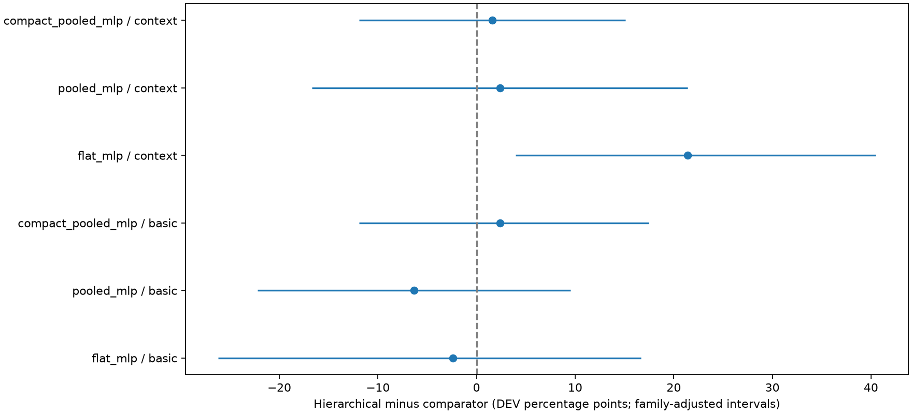
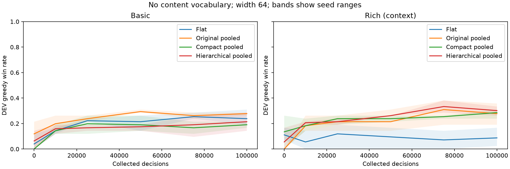

# Vantom compact and hierarchical encoding — 2026-10-14

Status: **complete and audited**. All 24 learners finished their 100k-decision
budget, totaling **2,400,000 collected and trained decisions**, with zero skipped
decisions, skipped updates or failed training episodes. The run started at
**2026-10-14 15:06:45 UTC (17:06 Amsterdam)** and completed at
**19:12:54 UTC (21:12 Amsterdam)**, taking **4h06m09s**.

Rich hierarchical pooling reached 30.2% greedy DEV wins, versus 27.8% for the
original rich pooled MLP, 28.6% for compact rich pooling and 8.7% for the rich
flat MLP. Only its comparison with rich flat excludes zero after the registered
family correction. Compact inputs substantially reduce memory; the extra
hierarchical aggregation has not established an advantage over ordinary pooling.
The compact rich model is a useful candidate for further experiments, retaining
the original pooled model as a baseline. The default model remains unchanged.

The first retained clock observation during implementation was 2026-10-14
14:38:08 UTC; earlier implementation time was not measured. The runner records
exact training and evaluation times, reported below. Results remain exploratory
after prior TEST exposure; no new TEST gameplay was performed.

The user authorized saving the [design](../AGENT_ENCODING.md#experimental-typed-combat-encoder),
implementing it and comparing it with both the existing pooled entity MLP and
the flat MLP. The saved diagram is [PNG](../assets/hierarchical-mlp/design.png)
and [SVG](../assets/hierarchical-mlp/design.svg).

## Registered comparison

Four designs × two feature levels × three seeds = **24 learners**, each with
**100,000 collected decisions**, totaling **2.4 million training decisions**.

| Design | Frontend | State aggregation |
| --- | --- | --- |
| Existing flat MLP | Original universal records | Flattened state, two hidden layers |
| Existing pooled MLP | Original universal records | Shared entity processing, global mean, linear critic |
| Compact pooled MLP | Typed records and shared ordered effect encoder | Global mean and linear critic |
| Hierarchical pooled MLP | Same compact frontend | Separate groups, counts, nonlinear state MLP |

Both **basic** and **context** (full rich) inputs are tested, all without content
vocabulary. Width is 64 throughout; parameter counts are allowed to differ and
are reported below. Shared effect vectors use width 32. Seeds are 11/29/47.
Baselines are freshly trained in the same checkout, not compared only with old
scores. No warm-up, demonstrations, transferred weights, previews or search.

| Design (width 64) | Basic parameters | Rich parameters |
| --- | ---: | ---: |
| Flat | 2,453,634 | 15,607,554 |
| Original pooled | 42,946 | 144,130 |
| Compact pooled | 42,626 | 97,698 |
| Hierarchical pooled | 145,922 | 200,994 |

All counts include connected trainable parameters, with zero content embedding
parameters. Compact records retain known flags and one magnitude per numerical
field. Role widths (basic/rich) are player 132/224, enemy 27/142, card 49/119,
potion 14/33, relic 14/33 and selection 47/47. Rich effect records have 143
channels and share a 32-unit encoder; basic inputs have no detailed effect list.
The dense original projection remains a transient CPU encoding/audit step.
Rollouts and networks consume only the packed compact records, without 128-row
dense padding. Existing schema bounds still fail explicitly on overflow.

Retain the existing 101 TRAIN fights/668 starts and 42 DEV openings, verified
public prefixes, fight-balanced opening/continuation sampler, 16 collectors and
four learner threads. Preserve the fixed PPO settings and bounded chunk schedule
from the prior study. Configuration order is deterministically shuffled within
seed blocks. Count collected, trained and skipped decisions separately, with no
budget extensions for unsuccessful learners.

Evaluate DEV greedy at 0/10k/25k/50k/75k/100k, two sampled repetitions at 100k,
and TRAIN openings greedy at 100k. Selection and comparisons use the 100k endpoint.
The six primary comparisons are hierarchical minus each of the other three
designs, at matched basic or rich inputs. Apply paired fight/seed bootstrap
intervals with a six-comparison family correction. Report frontend-only,
aggregation-only and rich-minus-basic differences as secondary exploratory
comparisons, with per-seed results and learning curves.

Report parameter counts, input/rollout memory, training and evaluation time,
inference time, win rates, health, rewarded episodes, PPO diagnostics, skipped
updates, feature coverage and missing history. Finite-width encoders may lose
information even when their inputs retain the same semantic facts.
Rollout/tensor bytes are logical array sizes. Parent-process peak RSS excludes
collectors and is a process-lifetime high-water mark, so it can include earlier
learners in the sequential run. Evaluation inference time includes encoding and
instrumentation; neither measure is an isolated hardware benchmark.

Original TEST reservations and ownership remain closed and unchanged. This is a
TRAIN/DEV-only exploratory study after prior TEST exposure; no new TEST gameplay
or default-model change is authorized.

## Acceptance before training

Check semantic round trips against original feature rows, identity renaming,
entity permutations and candidate mapping, batch isolation, ownership, nested
selections, effect order, unknown versus zero, padding, overflow, and all feature
removals. Verify zero-update initialization, old checkpoint loading, new checkpoint
round trips and exact bounded PPO resume. Run TRAIN-only disposable smoke learners,
one independent semantic review, and affected integration checks before freezing
and launching the full comparison.

## Implementation validation

- Compilation of `game` and `tests` passed. The affected model/checkpoint/PPO,
  parallel collection, zero-signal, feature-study, follow-up and compact suites
  passed **186 tests in 90.13 seconds**. Two additional native multi-card selection
  and overflow checks passed in **0.86 seconds**. The compact suite includes exact
  serial and two-collector PPO continuation for both new architectures.
- Historical no-vocabulary context checkpoints for graph, attention, original
  pooled and flat models retained their archive hashes, loaded successfully and
  produced finite outputs on a synthetic public combat observation.
- Independent semantic review completed **2026-10-14 14:51:03 UTC**, taking
  **7m24s**. It found no concrete blocker in feature preservation, information
  boundaries, ownership, batch offsets, empty groups, gradient flow, checkpoint
  bindings or the TRAIN/DEV-only matrix. The reviewer ran separate synthetic
  checks; the 186-test integration result was author-run evidence.
- Reviewed source build:
  `0371ef9dc02c199de96030159fa464171dc25861b4f8d4e0071e7af8244436a5`.
  Rules remain
  `a7aff887d75dc4de4e2691bb261c72886bdb863f47239dc7b025e71d008ee5cb`.
- The saved PNG/SVG figure was rendered and visually checked. Design/evidence
  links and whitespace validation passed.

Native source verification began **2026-10-14 14:51:25 UTC** and completed in
**612.69 seconds (10m13s)**. All 935 TRAIN/DEV starts were verified: 668 TRAIN
starts from 101 fights, and 267 DEV starts from 42 fights. DEV evaluation uses
only the 42 openings. No TEST gameplay was opened.

All eight TRAIN-only smoke learners completed in **88.61 seconds**, collecting
and training 128 decisions each, with zero skipped decisions/updates. Their
**1,024 disposable decisions are separate from the 2.4M main budget**.

The full TRAIN input audit completed in **136.57 seconds**. It restored verified
public history for all 668 starts, checked every architecture's finite forward
pass, compared original semantic rows and compact round trips, and verified
candidate mappings and policy masks. It applied **zero environment actions**
and trained no model. Maximum entities remained 16 for basic and 40 for rich;
the frozen capacity remains 128, with explicit overflow checks.

| Inputs | Original mean packed bytes | Compact mean packed bytes | Original mean collated bytes | Compact mean collated bytes |
| --- | ---: | ---: | ---: | ---: |
| Basic | 12,654 | 2,392 | 216,858 | 2,314 |
| Rich | 201,094 | 30,260 | 1,026,330 | 30,052 |

These are TRAIN-start observations, not a rollout distribution. Both compact
models share the new input representation. Rich packed inputs are **6.65×
smaller**, and single-observation collated tensors are **34.15× smaller**. Dense
audit rows still exist temporarily during encoding. This establishes a storage
reduction, not better win rates or lower measured runtime.

Artifacts are saved under
`runs/vantom-entity-encoding-20261014` in the primary repository's public run
directory. Its `preflight.json`, `semantic-review.json` and `input-audit.json`
record execution evidence; `execution.json` records the main run. The frozen
manifest SHA-256 is
`30e6e592c42f4b66467dd4c780307416b1828dd524de697b45402c07b16ca23a`.

The [local MLflow viewer](http://127.0.0.1:5053/#/experiments/1) serves this run
separately from the earlier flat comparison. All 24 learner runs and the
comparison run are FINISHED. Its 72 final DEV greedy, DEV sampled and TRAIN win
rates match the verified report. Both saved plots were visually checked.

## Completed outcomes

All rates below are percentages. Per-seed values are in **11 / 29 / 47** order.
Greedy DEV uses the same 42 source fights; sampled DEV averages two paired
repetitions per fight (84 episodes per learner). TRAIN evaluation uses the 101
openings, not all 668 continuation starts. Means weight the three seeds equally.

| Model / inputs | DEV greedy mean | DEV greedy seeds | DEV sampled mean | DEV sampled seeds | TRAIN greedy mean | TRAIN − DEV (pp) |
| --- | --- | --- | --- | --- | --- | --- |
| Flat · basic | 23.8 | 21.4 / 19.0 / 31.0 | 19.4 | 21.4 / 15.5 / 21.4 | 30.4 | +6.6 |
| Flat · rich | 8.7 | 16.7 / 7.1 / 2.4 | 0.4 | 1.2 / 0.0 / 0.0 | 9.9 | +1.2 |
| Original pooled · basic | 27.8 | 28.6 / 26.2 / 28.6 | 19.0 | 15.5 / 21.4 / 20.2 | 31.7 | +3.9 |
| Original pooled · rich | 27.8 | 35.7 / 28.6 / 19.0 | 23.0 | 26.2 / 21.4 / 21.4 | 44.2 | +16.4 |
| Compact pooled · basic | 19.0 | 19.0 / 16.7 / 21.4 | 21.8 | 21.4 / 21.4 / 22.6 | 26.4 | +7.4 |
| Compact pooled · rich | 28.6 | 31.0 / 23.8 / 31.0 | 22.2 | 20.2 / 26.2 / 20.2 | 42.2 | +13.7 |
| Hierarchical · basic | 21.4 | 28.6 / 21.4 / 14.3 | 15.9 | 22.6 / 9.5 / 15.5 | 27.7 | +6.3 |
| Hierarchical · rich | 30.2 | 33.3 / 26.2 / 31.0 | 15.1 | 19.0 / 7.1 / 19.0 | 36.0 | +5.8 |

No endpoint greedy DEV evaluation was cut off. The rich hierarchical model has
the highest greedy point estimate, but its 15.1% sampled win rate trails original
rich pooling (23.0%) and compact rich pooling (22.2%). Its lower TRAIN/DEV gap
also accompanies lower TRAIN performance; it does not by itself prove improved
generalization. Per-seed TRAIN rates and all raw evaluations remain in the audit
and comparison JSON.

## Paired comparisons

Differences are **percentage points, first model minus second**. The crossed
bootstrap resamples learner seeds and source fights while preserving pairing,
using 10,000 draws. Sampled repetitions are averaged within each fight and are
not independent fights. The six primary greedy contrasts use 99.1667% individual
intervals (Bonferroni allocation of a 5% family error rate). With only three
learner seeds, these exploratory bootstrap intervals give a coarse estimate of
initialization uncertainty. The ordinary 95% intervals are also shown; sampled
intervals are exploratory and not family-adjusted.

| Primary contrast | Greedy Δ [95%] | Greedy Δ [family-adjusted] | Sampled Δ [95%] |
| --- | --- | --- | --- |
| Hierarchical · basic − Flat · basic | -2.4 [-17.5, +11.9] | -2.4 [-26.2, +16.7] | -3.6 [-9.5, +3.6] |
| Hierarchical · basic − Original pooled · basic | -6.3 [-17.5, +4.8] | -6.3 [-22.2, +9.5] | -3.2 [-14.3, +8.3] |
| Hierarchical · basic − Compact pooled · basic | +2.4 [-7.1, +13.5] | +2.4 [-11.9, +17.5] | -6.0 [-14.7, +2.0] |
| Hierarchical · rich − Flat · rich | +21.4 [+8.7, +34.9] | +21.4 [+4.0, +40.5] | +14.7 [+5.6, +25.8] |
| Hierarchical · rich − Original pooled · rich | +2.4 [-11.1, +15.9] | +2.4 [-16.7, +21.4] | -7.9 [-16.7, +1.2] |
| Hierarchical · rich − Compact pooled · rich | +1.6 [-7.9, +11.1] | +1.6 [-11.9, +15.1] | -7.1 [-20.2, +4.4] |

Only **rich hierarchical versus rich flat** excludes zero in the primary
adjusted intervals. Hierarchical versus compact isolates the added aggregation
and nonlinear state network at a shared frontend; neither feature level provides
clear evidence that this addition improves wins.

The following six secondary comparisons are unadjusted exploratory 95% intervals.

| Secondary contrast | Greedy Δ [95%] | Sampled Δ [95%] |
| --- | --- | --- |
| Flat · rich − Flat · basic | -15.1 [-31.7, +0.0] | -19.0 [-29.8, -10.3] |
| Original pooled · rich − Original pooled · basic | +0.0 [-14.3, +15.1] | +4.0 [-6.3, +14.7] |
| Compact pooled · rich − Compact pooled · basic | +9.5 [+0.8, +19.0] | +0.4 [-7.5, +9.1] |
| Hierarchical · rich − Hierarchical · basic | +8.7 [-3.2, +20.6] | -0.8 [-8.3, +7.1] |
| Compact pooled · basic − Original pooled · basic | -8.7 [-19.0, +0.0] | +2.8 [-6.0, +9.5] |
| Compact pooled · rich − Original pooled · rich | +0.8 [-12.7, +14.3] | -0.8 [-8.7, +8.3] |

Richer features improve greedy point estimates for compact pooling (+9.5 pp)
and hierarchical pooling (+8.7 pp), leave original pooling unchanged, and reduce
the flat model's score by 15.1 pp. Compact pooling's positive interval excludes
zero at the nominal 95% level; it is one of six secondary comparisons and is not
confirmatory evidence. Richness produces no resolved sampled-play improvement
for any entity model. The rich flat decline is also visible in sampled play.
These comparisons concern whole feature bundles, not the causal value of any
individual feature.

The compact frontend alone changes the original pooled greedy score by −8.7 pp
on basic inputs and +0.8 pp on rich inputs. This supports testing the compact
rich representation for its memory savings, but does not establish equivalence
or superiority to the original model.

## Learning dynamics

Mean greedy DEV win rates at the fixed decision milestones:

| Model / inputs | 0 | 10k | 25k | 50k | 75k | 100k | 100k − initialization (pp) |
| --- | --- | --- | --- | --- | --- | --- | --- |
| Flat · basic | 4.0 | 14.3 | 22.2 | 21.4 | 25.4 | 23.8 | +19.8 |
| Flat · rich | 11.1 | 5.6 | 11.9 | 9.5 | 7.1 | 8.7 | -2.4 |
| Original pooled · basic | 11.9 | 19.8 | 23.8 | 29.4 | 26.2 | 27.8 | +15.9 |
| Original pooled · rich | 0.0 | 18.3 | 21.4 | 21.4 | 31.0 | 27.8 | +27.8 |
| Compact pooled · basic | 0.0 | 14.3 | 19.8 | 19.0 | 16.7 | 19.0 | +19.0 |
| Compact pooled · rich | 13.5 | 18.3 | 23.8 | 23.8 | 25.4 | 28.6 | +15.1 |
| Hierarchical · basic | 6.3 | 15.9 | 16.7 | 17.5 | 19.0 | 21.4 | +15.1 |
| Hierarchical · rich | 5.6 | 20.6 | 21.4 | 26.2 | 33.3 | 30.2 | +24.6 |

The original basic pooled model peaks at the observed 50k checkpoint; rich
hierarchical and original rich pooled models decline between 75k and 100k.
Compact rich pooling continues improving over that interval. The rich flat model
ends below its random-initialization greedy score. Thus earlier checkpoint
rankings differ, and the registered 100k endpoint remains the comparison point.
The saved `learning-curves.png` shades the **range of three seeds**, not a
confidence interval. `architecture-comparisons.png` displays all six primary
family-adjusted intervals.

## Runtime, memory and learning diagnostics

Training times below average the three 100k learners and exclude evaluations.
Throughput is total collected decisions divided by those training times. Input
bytes are actual packed rollout payload per collected decision; maximum minibatch
bytes are logical collated input tensor bytes across all updates of that setup.
They exclude activations, gradients, optimizer state and temporary CPU audit rows.

| Model / inputs | Train s / learner | Collect s | Update s | Decisions/s | DEV inference ms/decision | Packed KiB/decision | Largest minibatch MiB |
| --- | --- | --- | --- | --- | --- | --- | --- |
| Flat · basic | 507.8 | 436.8 | 61.0 | 196.9 | 5.55 | 10.66 | 3.316 |
| Flat · rich | 791.0 | 482.9 | 286.8 | 126.4 | 8.21 | 198.43 | 15.669 |
| Original pooled · basic | 477.3 | 431.4 | 37.8 | 209.5 | 5.25 | 10.66 | 3.316 |
| Original pooled · rich | 531.0 | 455.6 | 66.6 | 188.3 | 6.71 | 201.75 | 15.670 |
| Compact pooled · basic | 489.1 | 443.6 | 37.1 | 204.4 | 6.28 | 1.97 | 0.047 |
| Compact pooled · rich | 537.7 | 475.6 | 53.5 | 186.0 | 12.01 | 30.11 | 0.548 |
| Hierarchical · basic | 496.1 | 443.3 | 44.3 | 201.6 | 6.26 | 1.98 | 0.050 |
| Hierarchical · rich | 544.4 | 474.9 | 60.9 | 183.7 | 11.76 | 30.06 | 0.544 |

Rich compact/hierarchical rollouts use about **6.7× less packed input storage**
than original rich pooling. Their largest collated minibatches are about
0.55 MiB versus 15.67 MiB. The rich compact model has 97,698 parameters versus
144,130 for original pooling, 200,994 for hierarchical pooling and 15,607,554 for
flat. These are equal-width comparisons, not parameter-matched comparisons;
encoder depth and initialization behavior also differ.

Storage savings did **not** translate to lower measured latency. Rich compact and
hierarchical inference averaged 12.01/11.76 ms, versus 6.71 ms for original rich
pooling; training throughput was 186.0/183.7 versus 188.3 decisions/s. Collection
still constructs the original semantic projection before packing, and timings
include instrumentation and process contention. The observed parent-process RSS
high-water mark reached 4.11 GiB, excludes collectors, and carries over from
preceding learners. It cannot establish a per-model total-memory comparison.

Every learner trained all 100k collected decisions. Across 768 update iterations,
there were **zero zero-signal skipped updates**. Eight iterations stopped PPO
epochs early at the KL guard (two rich flat, one rich compact, five rich
hierarchical); these were updates with gradients, not skipped rollouts. There
were 20,756 rewarded training episodes out of 124,905 episode attempts, and zero
failed episodes. Episodes may be budget-truncated; they are not independent
source fights.
Here, trained decisions count decisions in rollouts with an update. This historical
run did not measure unique optimizer coverage; the
[subsequent PPO calibration](VANTOM_SHARED_PPO_2026_10_15.md#learning-dynamics-and-optimizer-exposure)
adds that accounting rather than assuming every decision received gradients.

The next table reports totals of rewarded episodes across three seeds, first
reward in deterministic collected-episode order per seed (not worker wall-clock
order), and means of the final update's post-update diagnostics. These are not
whole-run averages.

| Model / inputs | Rewarded episodes | First reward decisions (11/29/47) | Entropy | Approx. KL | Clip fraction | Value MSE |
| --- | --- | --- | --- | --- | --- | --- |
| Flat · basic | 2709 | 288 / 573 / 365 | 0.789 | 0.00877 | 6.75% | 0.0449 |
| Flat · rich | 715 | 289 / 573 / 349 | 1.298 | 0.00007 | 0.07% | 0.0024 |
| Original pooled · basic | 3071 | 289 / 573 / 349 | 0.640 | 0.00410 | 3.98% | 0.0512 |
| Original pooled · rich | 2949 | 289 / 755 / 320 | 0.702 | 0.00508 | 5.46% | 0.0477 |
| Compact pooled · basic | 2868 | 289 / 755 / 1476 | 0.722 | 0.00580 | 6.97% | 0.0464 |
| Compact pooled · rich | 3028 | 288 / 573 / 320 | 0.728 | 0.00326 | 3.10% | 0.0319 |
| Hierarchical · basic | 2774 | 289 / 573 / 234 | 0.748 | 0.00709 | 4.98% | 0.0485 |
| Hierarchical · rich | 2642 | 289 / 755 / 349 | 0.906 | 0.01097 | 9.88% | 0.0157 |

The rich flat model has few rewarded episodes, very low final KL and poor sampled
wins. Its low value MSE therefore does not establish a useful critic; mostly
zero returns can be easy to predict. The diagnostics establish successful bounded
execution, not that the shared PPO hyperparameters are optimal for each design.

## Health, coverage and scope

Health means are descriptive: settled winning HP is conditional on each seed's
own wins, whereas boss HP averages all endpoints. Different win sets make raw
winning-HP comparisons unsuitable as a standalone model ranking.

| Model / inputs | Settled winning player HP (% maximum) | Remaining boss HP |
| --- | --- | --- |
| Flat · basic | 19.3 | 47.4 |
| Flat · rich | 18.9 | 86.6 |
| Original pooled · basic | 24.9 | 42.6 |
| Original pooled · rich | 31.0 | 37.3 |
| Compact pooled · basic | 26.5 | 46.2 |
| Compact pooled · rich | 25.9 | 35.5 |
| Hierarchical · basic | 28.1 | 45.5 |
| Hierarchical · rich | 23.5 | 38.8 |

For paired rich hierarchical comparisons, conditioning on **both models winning**
gives player-HP differences of +7.3 versus flat (95% interval −6.0 to +22.3;
7 seed/fight pairs), −3.3 versus original pooling (−11.9 to +3.4; 23 pairs), and
+0.2 versus compact pooling (−7.4 to +5.0; 25 pairs). These conditional samples
are small. On common failures, hierarchical leaves 47.5 less boss HP than flat
(95% interval −81.6 to −19.6; 84 pairs); differences from either pooled model
span zero. These are descriptive, unadjusted comparisons, recorded with support
counts in `completion-audit.json`.

Feature audits inspect the common semantic projection along endpoint DEV greedy
trajectories; their denominators differ because policies visit different states.
The audit dimensions are 293 basic and 1,874 rich columns and are **not** compact
network input widths. Basic has 123 columns (42.0%) constant within every seed's
endpoint audit. Rich entity models have 1,337 such columns (71.3%); rich flat has
1,343 (71.7%). Constant channels can reflect Vantom's narrow content and structural
fields; absence of variation is not evidence that a feature is unnecessary in
other fights.

For rich inputs, known turn-play counters are unavailable on 12.3–16.3% of
observed decisions, energy-spent counters on 12.3–16.2%, and status-draw counters
on 82.6–90.1%. These retain explicit unknown flags; they are not supplied as
invented zero counts. The enemy-history completeness flag reports no missing
prefixes in these DEV opening rollouts. Individual history slots are absent on
9.9–17.4%, 18.6–32.4% and 28.0–47.6% of applicable enemy rows respectively,
consistent with early turns before three prior profiles exist. This differs from
a missing public prefix. The full TRAIN-start audit also restored verified
continuation history. Basic inputs omit these families, so their default zero
audit counters are not evidence of complete history. Unknown-value rates for
inapplicable effect operands should not be read as missing mechanical knowledge.

The DEV sample contains 38 healthy and only four damaged-HP openings, 33 small
(≤20 cards) and nine medium (21–30 cards) decks, no large decks, 18 fights with
potions and 24 without, and 17 fights containing content absent from the TRAIN
content set. All setups lose all four damaged-HP openings. Rich greedy wins on
the 17 unseen-content fights are 9.8% flat, 21.6% original pooled, 25.5% compact
and 27.5% hierarchical. These are small descriptive slices, not additional
independent tests; the full per-seed slice results are saved in the report.

The experiment supports compact typed inputs as a substantially smaller
representation with competitive rich-feature point estimates. **Use rich compact
pooling as a candidate for the next study, alongside the original pooled
baseline.** The extra hierarchy has not established better greedy performance
than either pooled comparator and has a worse sampled point estimate. Retain
basic flat as a simple baseline; the rich flat model is a poor choice under this
particular 100k/shared-PPO budget. Do not infer that all rich features help, that
hierarchical pooling is generally better, or that the current PPO settings are
universally suitable. No default or hyperparameter change was made.
The [shared calibration](VANTOM_SHARED_PPO_2026_10_15.md) subsequently tested
recipe transfer on the original and compact rich pooled models with fresh seeds.
Its results are a separate update-semantics experiment, not a replacement for
the frozen architecture comparisons above.

## Completion verification and timings

The post-run audit checked all 24 unique learners, exact configuration bindings,
zero-update initializations, frozen source identity, final checkpoint byte hashes,
and initial/final private resume payload digests. Resume counters, 16 collectors
and four update threads match the frozen allocation. All 288 bounded training
segments completed; all **192 evaluations / 10,488 evaluation episodes** have
complete source/split/mode/repetition bindings and recorded SHA-256 hashes. This
is 6×42 DEV greedy, 2×42 DEV sampled and 101 TRAIN episodes per learner.

The six primary and six secondary comparisons were recomputed from the saved
per-fight outcomes and exactly matched the report. Source dependencies and original
ownership bindings remain unchanged; the verified source records TEST unopened.
The audit executes no gameplay. The local MLflow server returned HTTP 200 and
all 25 runs were FINISHED; all 72 endpoint win-rate metrics matched the report.
No training restart, tuning or budget extension was performed.

| Phase | Measured elapsed time |
| --- | ---: |
| Implementation | Earlier work unmeasured; first retained clock 14:38:08 UTC |
| Independent semantic review | 7m24s |
| Affected integration tests | 90.13s + 0.86s |
| Native TRAIN/DEV source verification | 612.69s |
| Eight disposable smoke learners | 88.61s |
| All-668-TRAIN-start input audit | 136.57s |
| Main sequential run, wall clock | 14,769.49s (4h06m09s) |
| Recorded training segments, summed | 13,123.35s (3h38m43s) |
| Recorded evaluations, summed | 1,403.27s (23m23s) |
| Final comparison/plot report generation | 1.50s |
| Analysis and documentation after successful audit | 374.32s (19:13:49–19:20:03 UTC) |

The remaining approximately 241 seconds of main wall time covers initialization,
checkpoint and orchestration work outside the summed segment/evaluation timers;
these are not separately profiled. Earlier phases can overlap and should not be
added as a serial implementation duration. The last row starts at the verified
audit timestamp; earlier completion-check and audit work was not separately timed.

All public outputs are under
`/Users/rowdeygoos/code/github/RowdeyGoos/StS_agent/runs/vantom-entity-encoding-20261014`.
The `report/` directory contains `comparisons.json`, the two checked plots,
`completion-audit.json`, the read-only verification script, and a copy of this
results record. Learner directories preserve public trajectories and checkpoints;
private resume artifacts retain their separate private paths.

- Frozen manifest SHA-256:
  `30e6e592c42f4b66467dd4c780307416b1828dd524de697b45402c07b16ca23a`.
- Completed comparison report SHA-256:
  `49f97fe8afc1b92bd673a38d9681988d7a0fd7187da47bfa08715a00f8f65eeb`.
- The complete checkpoint/evaluation bindings and audit timestamp are in
  `report/completion-audit.json`; no historical evidence was repinned.
