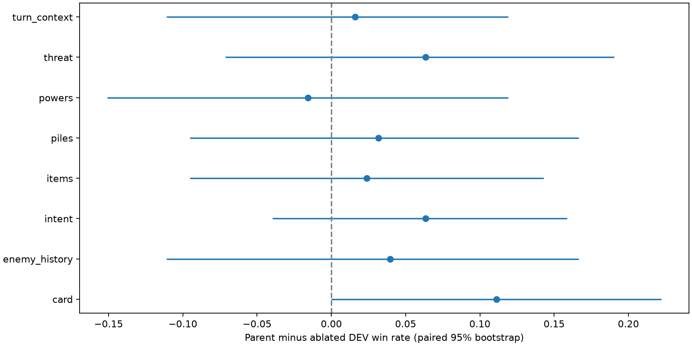
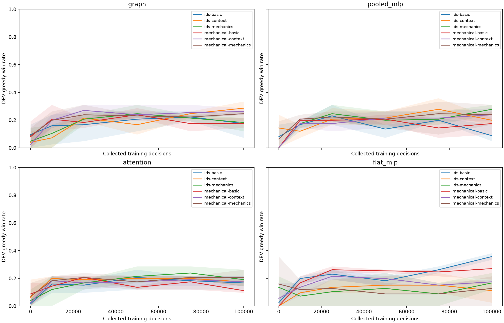

# Vantom feature and architecture study — 2026-10-12

## Scope and status

The approved study compares 24 architecture/identity/richness configurations and
eight follow-up removals, three seeds each, at 100,000 collected PPO decisions
from random initialization. No warm-up, demonstrations, search or action previews
are used. The implementation is in `game/agent/training/study/`; the canonical
entry point is `sts-agent-train feature-study`. No default model is changed.

**Complete at 2026-10-12 21:30:25 UTC:** all 96 learners collected and trained
exactly 100,000 decisions each, totaling **9,600,000 decisions**, with no skipped
decisions or updates. Registered held-out confirmation also completed. The
output's generated `report/README.md`, `report/comparisons.json` and
`execution.json` own the detailed results and execution status. The output directory is
`/Users/rowdeygoos/code/github/RowdeyGoos/StS_agent/runs/vantom-feature-study-20261012-r3/`.
Code executes from the current worktree; outputs use the existing public project
directory because inspector/MLflow guards reject hidden ancestors. Verification,
independent review, eight-model smoke and report publication passed. The full
sequential runner started **2026-10-11 23:33:54 UTC** and exited successfully
after **21 hours, 56 minutes, 30 seconds**. This file records observed outcomes,
not performance inferred from implementation tests.
Here, trained decisions count decisions in rollouts that received an update;
this historical run did not measure unique optimizer coverage. The later
[PPO calibration](VANTOM_SHARED_PPO_2026_10_15.md#learning-dynamics-and-optimizer-exposure)
reports that distinction explicitly.

The [training guide](../AGENT_TRAINING.md#vantom-feature-and-architecture-study)
owns usage. The [configuration](../../configs/training/vantom_feature_study.json)
and [pinned crosswalk](../../configs/training/vantom_alphaspire_crosswalk.json)
own the experimental settings and reference feature inventory. The reference is
[AlphaSpire encoding revision 9774eca](https://github.com/AlphaSpire2/alphaspire/blob/9774eca833588cae88dea01f34422a8b0758cf14/src/encoding.rs)
and its [encoding tests](https://github.com/AlphaSpire2/alphaspire/blob/9774eca833588cae88dea01f34422a8b0758cf14/tests/encoding.rs).

## Evidence boundaries

- Original populations: 101 TRAIN fights/668 starts, 42 DEV openings, 57 reserved
  TEST openings. The current-source derivative verifies TRAIN/DEV public prefixes
  and native restoration without opening TEST gameplay or replacing source hashes.
- The common semantic projection binds feature groups, catalog, capacities,
  history semantics and optional TRAIN-fitted identity names into checkpoints.
  No-vocabulary inputs contain no content-name embeddings, hashes or ordinals.
- Threat summaries describe displayed pressure. Enemy history uses public intent
  profiles with ownership and recency, never private AI moves. Missing history,
  ambiguous automatic plays and uncertain payments are explicitly unknown.
- Card/power/item removal also removes reconstructed turn counters because
  completeness can disclose excluded automatic-play mechanics. Such comparisons
  are coupled removals. Static mechanic coverage is incomplete and reported.
- Width matching may produce a narrow flat network. Equal parameters do not imply
  equal compute or equal inductive bias. Memory measurements cover parent RSS.
- TEST confirmation registers both three-seed finalists and controls once and
  reserves each individual attempt before snapshot access. No tuning or
  reselection follows test exposure.

## Completed results and recommendation

The development-selected research candidate is **`flat_mlp-ids-basic`**, a
fully connected network with basic tactical inputs and learned content embeddings.
It achieved **35.7% greedy DEV wins** and **33.3% greedy TEST wins**. The selected
no-vocabulary finalist, **`graph-mechanical-context-without-powers`**, achieved
**27.8% DEV** and **25.1% TEST**. Both beat the heuristic in the registered test
comparisons; their head-to-head difference remains unresolved. Retain the simple
MLP as the leading candidate for further research, with the semantic graph model
as a viable alternative. The default model is unchanged.

Rates below average the three learner seeds (11, 29, 47). DEV has 42 source
fights; TEST has 57. Sampled evaluation uses two repetitions per fight and seed.
Controls are single policies rather than three independently trained learners.

| Frozen finalist/control | TRAIN greedy | DEV greedy | DEV sampled | TEST greedy | TEST sampled |
| --- | ---: | ---: | ---: | ---: | ---: |
| Flat MLP, identities, basic | 39.9% | 35.7% | 21.8% | 33.3% | 27.8% |
| Graph, no vocabulary, context, powers removed | 30.4% | 27.8% | 11.1% | 25.1% | 9.1% |
| Heuristic | — | — | — | 10.5% | 10.5% |
| Random legal | — | — | — | 0.0% | 0.0% |

TEST greedy wins by seed were **18/57, 17/57, 22/57** for the identity finalist
and **19/57, 14/57, 10/57** for the no-vocabulary finalist. Heuristic wins were
6/57. All **1,368 registered TEST episodes** terminated without failures or
cutoffs. Repeated evaluations share source fights and are not independent cases.
Sampled play was substantially weaker than greedy play for the graph finalist;
the sampled rates are descriptive, not additional registered superiority tests.

The three pre-registered greedy comparisons use 10,000 paired bootstrap draws
over source fights and learner seeds, with Bonferroni-adjusted **98.333%**
individual intervals (a nominal 95% family). Differences are percentage points:

| Registered TEST comparison | Difference | Adjusted interval |
| --- | ---: | ---: |
| Identity finalist − no-vocabulary finalist | +8.2 pp | [−9.9, +27.5] pp |
| Identity finalist − heuristic | +22.8 pp | [+10.5, +36.8] pp |
| No-vocabulary finalist − heuristic | +14.6 pp | [+1.8, +30.4] pp |

The finalists differ in architecture and inputs as well as identity use. Their
comparison does not isolate the value of vocabulary. In the 12 matched DEV
identity comparisons, all exploratory 95% intervals include zero. For example,
the basic flat MLP scored 35.7% with identities and 27.0% without, an **8.7 pp**
difference with interval **[−3.2, +22.2] pp**. Content embeddings are useful to
keep testing, but this experiment does not establish that they are necessary or
consistently helpful.

### Architecture and richness

These are all 24 main configurations' mean 100k DEV greedy win rates. The eight
removals were trained afterward on the selected rich no-vocabulary graph parent.

| Architecture | Identity inputs | Basic tactical | Detailed mechanics | Mechanics plus context |
| --- | --- | ---: | ---: | ---: |
| Flat MLP | Learned identities | **35.7%** | 16.7% | 11.1% |
| Flat MLP | No vocabulary | 27.0% | 12.7% | 17.5% |
| Graph | Learned identities | 17.5% | 18.3% | 28.6% |
| Graph | No vocabulary | 17.5% | 24.6% | 26.2% |
| Pooled entity MLP | Learned identities | 8.7% | 27.8% | 19.8% |
| Pooled entity MLP | No vocabulary | 17.5% | 23.8% | 23.8% |
| Entity attention | Learned identities | 16.7% | 19.0% | 17.5% |
| Entity attention | No vocabulary | 11.1% | 20.6% | 17.5% |

Richness improved the graph's observed results, while the pooled model did best
with mechanics and attention did not lead this screen. More inputs were not
uniformly better. These are exploratory rankings, not established universal
architecture orderings.

All configurations were matched around two million parameters. The flat basic
models used **51/52 hidden units**, versus **nine** for mechanics and **eight**
for context. Rich flat models therefore had a severe hidden-width constraint;
their weak results do not establish that richer features are harmful. Any future
flat-rich comparison should address this bottleneck. The subsequent
[equal-width study](VANTOM_FLAT_WIDTH_2026_10_13.md) did so; its results do not
alter this study's frozen selection or TEST conclusions. The identity finalist has
2,009,073 parameters (1,456 embeddings); the graph finalist has 1,999,622 and no
embeddings. Their mean measured TEST greedy inference times were approximately
**5.98 ms** and **8.57 ms per decision**, respectively, with instrumentation.
Equal parameter counts did not produce equal compute.

The four identity-by-context interactions compare the identity effect under
context inputs with that under basic inputs: `(IDs − no vocabulary)context`
minus `(IDs − no vocabulary)basic`. None was resolved by its exploratory
paired 95% interval. Widths also vary under parameter matching.

| Architecture | Interaction | Paired 95% interval |
| --- | ---: | --- |
| graph | +2.4 pp | [-9.5, +14.3] pp |
| pooled_mlp | +4.8 pp | [-13.5, +26.2] pp |
| attention | -5.6 pp | [-17.5, +6.3] pp |
| flat_mlp | -15.1 pp | [-38.1, +4.8] pp |

### Feature removals

Parent: `graph-mechanical-context`, **26.2%** DEV greedy wins. Positive drops below
mean that removing the feature reduced wins. Intervals are exploratory paired
95% intervals, conditional on this selected parent, without multiplicity adjustment.

| Removed group | DEV greedy | Drop from parent | Interval on drop |
| --- | ---: | ---: | ---: |
| Printed card effects and modifier details | 15.1% | +11.1 pp | [0.0, +22.2] pp |
| Current enemy intent | 19.8% | +6.3 pp | [−4.0, +15.9] pp |
| Engineered threat summaries | 19.8% | +6.3 pp | [−7.1, +19.0] pp |
| Recent enemy history | 22.2% | +4.0 pp | [−11.1, +16.7] pp |
| Public pile composition | 23.0% | +3.2 pp | [−9.5, +16.7] pp |
| Potion/relic mechanics and counters | 23.8% | +2.4 pp | [−9.5, +14.3] pp |
| Turn counters and compact run context | 24.6% | +1.6 pp | [−11.1, +11.9] pp |
| Visible powers and status stacks | 27.8% | −1.6 pp | [−15.1, +11.9] pp |

No removal effect is statistically resolved: every interval touches or crosses
zero. Card mechanics are the strongest candidate for further investigation,
followed by current intent and threat summaries. The apparent benefit of removing
powers is too uncertain to justify discarding them. Card, power and item removals
also suppress reconstructed turn counters; intent removal suppresses derived
pressure summaries. These are coupled interventions, not isolated causal effects.

Coverage further limits conclusions. On the rich parent's endpoint DEV traces,
public enemy-history missing flags were zero, but action/energy counters were
unknown on **12.4–13.4%** of decisions and status-draw counts on **82.3–83.1%**.
Known status-draw values and ascension channels were constant across each seed's
traces. Features that were absent, constant or incompletely described cannot be
judged as unimportant from this study.

### Learning dynamics and completion checks

Increasing the budget from 50k to 100k changed the descriptive main-screen
ranking. The basic no-vocabulary flat MLP led at 50k with **25.4%**, while the
eventual identity finalist was at **18.3%** and reached **35.7%** at 100k. Selection
remained fixed to the pre-registered 100k endpoint.

| Configuration | Initialization | 10k | 25k | 50k | 75k | 100k |
| --- | ---: | ---: | ---: | ---: | ---: | ---: |
| Flat MLP, identities, basic | 2.4% | 19.8% | 23.0% | 18.3% | 26.2% | 35.7% |
| Flat MLP, no vocabulary, basic | 0.0% | 16.7% | 26.2% | 25.4% | 24.6% | 27.0% |
| Graph, no vocabulary, context parent | 2.4% | 19.8% | 27.0% | 23.8% | 25.4% | 26.2% |
| Graph, no vocabulary, powers removed | 4.8% | 19.8% | 27.0% | 21.4% | 24.6% | 27.8% |

Shading shows the three-seed range, not a confidence interval. The plots retain
the frozen study's results; subsequent comparisons are linked from the
[current findings](../AGENT_TRAINING.md#current-vantom-findings).

Read-only completion verification checked all 96 learner statuses and decision
totals, all six DEV greedy checkpoints per learner, the frozen manifest hash,
all six reserved finalist checkpoint hashes, and the complete TEST report.
TEST contains 57 source fights and 1,368 unique policy/case/mode/repeat entries.
No additional evaluation, retraining or reselection was performed to write this
record. The report binds manifest
`6e591f3d5ceb7acb63b1a3d2ca8995f802055a9a2a965d007db6674ffbe426e1`.
The completed comparison report SHA-256 is
`5fcd3062382b51b9c6abbc9057e5219e0b99e040f00aa39566695653cb7dc2fd`.

The evidence supports learned Vantom combat policies at this budget, but not a
definitive general model ranking or a settled list of dispensable features.
Three seeds, one boss dataset, incomplete mechanic coverage and the flat model's
width constraint all limit generalization.

### All learner endpoints

These are all 96 learners, grouped by frozen configuration. Seed columns are
**11 / 29 / 47**; DEV greedy uses 42 openings and sampled DEV uses two
repetitions per opening. `ids` denotes learned identities and `mechanical`
denotes no content vocabulary. TRAIN means use 101 openings per seed.
All rates below are percentages. The separate greedy and sampled figures
must not be pooled as additional independent fights.

| Configuration | DEV greedy seeds | DEV sampled seeds | TRAIN greedy mean |
| --- | --- | --- | ---: |
| `attention-ids-basic` | 21.4 / 16.7 / 11.9 | 7.1 / 13.1 / 20.2 | 24.4 |
| `attention-ids-context` | 19.0 / 14.3 / 19.0 | 15.5 / 13.1 / 21.4 | 28.7 |
| `attention-ids-mechanics` | 26.2 / 16.7 / 14.3 | 17.9 / 13.1 / 21.4 | 29.0 |
| `attention-mechanical-basic` | 9.5 / 14.3 / 9.5 | 16.7 / 16.7 / 21.4 | 26.7 |
| `attention-mechanical-context` | 14.3 / 16.7 / 21.4 | 19.0 / 14.3 / 19.0 | 28.4 |
| `attention-mechanical-mechanics` | 21.4 / 26.2 / 14.3 | 15.5 / 14.3 / 21.4 | 29.7 |
| `flat_mlp-ids-basic` | 35.7 / 33.3 / 38.1 | 20.2 / 27.4 / 17.9 | 39.9 |
| `flat_mlp-ids-context` | 16.7 / 2.4 / 14.3 | 1.2 / 1.2 / 9.5 | 20.5 |
| `flat_mlp-ids-mechanics` | 23.8 / 11.9 / 14.3 | 1.2 / 0.0 / 1.2 | 17.2 |
| `flat_mlp-mechanical-basic` | 35.7 / 19.0 / 26.2 | 25.0 / 27.4 / 16.7 | 33.0 |
| `flat_mlp-mechanical-context` | 16.7 / 19.0 / 16.7 | 1.2 / 0.0 / 0.0 | 20.1 |
| `flat_mlp-mechanical-mechanics` | 0.0 / 21.4 / 16.7 | 1.2 / 0.0 / 0.0 | 11.9 |
| `graph-ids-basic` | 26.2 / 19.0 / 7.1 | 22.6 / 8.3 / 4.8 | 26.1 |
| `graph-ids-context` | 33.3 / 33.3 / 19.0 | 20.2 / 14.3 / 15.5 | 42.6 |
| `graph-ids-mechanics` | 21.4 / 21.4 / 11.9 | 14.3 / 19.0 / 14.3 | 34.3 |
| `graph-mechanical-basic` | 21.4 / 16.7 / 14.3 | 16.7 / 11.9 / 21.4 | 25.7 |
| `graph-mechanical-context` | 23.8 / 28.6 / 26.2 | 2.4 / 19.0 / 19.0 | 35.6 |
| `graph-mechanical-context-without-card` | 9.5 / 16.7 / 19.0 | 8.3 / 10.7 / 17.9 | 24.4 |
| `graph-mechanical-context-without-enemy_history` | 31.0 / 14.3 / 21.4 | 22.6 / 11.9 / 6.0 | 38.9 |
| `graph-mechanical-context-without-intent` | 21.4 / 19.0 / 19.0 | 9.5 / 9.5 / 17.9 | 37.0 |
| `graph-mechanical-context-without-items` | 26.2 / 28.6 / 16.7 | 15.5 / 20.2 / 15.5 | 42.6 |
| `graph-mechanical-context-without-piles` | 26.2 / 31.0 / 11.9 | 7.1 / 13.1 / 21.4 | 32.3 |
| `graph-mechanical-context-without-powers` | 33.3 / 21.4 / 28.6 | 8.3 / 19.0 / 6.0 | 30.4 |
| `graph-mechanical-context-without-threat` | 21.4 / 28.6 / 9.5 | 16.7 / 16.7 / 10.7 | 30.4 |
| `graph-mechanical-context-without-turn_context` | 31.0 / 21.4 / 21.4 | 20.2 / 9.5 / 14.3 | 34.3 |
| `graph-mechanical-mechanics` | 23.8 / 26.2 / 23.8 | 9.5 / 16.7 / 15.5 | 36.6 |
| `pooled_mlp-ids-basic` | 4.8 / 4.8 / 16.7 | 3.6 / 1.2 / 6.0 | 14.9 |
| `pooled_mlp-ids-context` | 16.7 / 21.4 / 21.4 | 16.7 / 17.9 / 16.7 | 39.9 |
| `pooled_mlp-ids-mechanics` | 31.0 / 23.8 / 28.6 | 27.4 / 19.0 / 16.7 | 38.6 |
| `pooled_mlp-mechanical-basic` | 16.7 / 26.2 / 9.5 | 9.5 / 9.5 / 15.5 | 26.7 |
| `pooled_mlp-mechanical-context` | 28.6 / 19.0 / 23.8 | 11.9 / 13.1 / 17.9 | 38.9 |
| `pooled_mlp-mechanical-mechanics` | 31.0 / 23.8 / 16.7 | 13.1 / 8.3 / 10.7 | 33.3 |

## Implementation validation

Focused tests cover identity renaming, ownership, offered choices reaching actor
and critic, padding/masks/batch isolation, nested selections, mixed attack/buff
intents, threat edge cases, modifier boundaries, prefix/history restoration,
feature-removal paths, zero-update initialization, checkpoint compatibility,
parallel exact resume, split closure, test attempt reservations, public playback,
paired fight/seed statistics, and idempotent MLflow collected-decision metrics.

The latest initial focused run passed **116 tests in 12.67 seconds**. Additional
protocol tests passed **13 tests in 5.07 seconds**, including a new two-collector
exact-resume check. The report/MLflow consumer check passed separately in
**9.48 seconds**. Affected integration passed **179 tests in 193.18 seconds**,
with one optional dependency test skipped and one HTTP test blocked by the
sandbox's socket permission. The HTTP test passed separately with loopback access
in **0.59 seconds**. The final inspector-copy regression passed in **0.62 seconds**:
four examples retain verified history, and private path substitution is rejected
before bytes are copied.

The independent semantic reviewer reported no remaining core semantic blockers
after checking information boundaries, history uncertainty, ablation masks,
checkpoint bindings, split ownership, test reservation and fight-level statistics.
Its independent synthetic content-renaming check also reordered draw entities
and verified actor/critic invariance for all four architectures. The final
reporting pass completed at **2026-10-11 22:54:23 UTC**, taking **204 seconds**;
the earlier review duration was not recorded. It also checked TEST time accounting,
idempotent MLflow steps and public inspector-copy validation. The reviewer changed
no files and opened no held-out gameplay. `semantic-review.json` records the review
against build `e24e1878f02cf2ab4c69062bcc260dce3c8e205c958925946583c73170208283`
and rules `a7aff887d75dc4de4e2691bb261c72886bdb863f47239dc7b025e71d008ee5cb`.

The first full derivative verified all **935 TRAIN/DEV starts in 564.30 seconds**.
Its eight-model smoke stopped in the first model before collecting any decisions:
the prefix endpoint included the adapter's attachment-only action log, while a
fresh native snapshot restore had an empty log. All other public endpoint fields
matched. These artifacts remain at the original output path without the `-r2`
suffix; they are not completed study learners.

The correction omits only attachment-owned run history when comparing a raw
prefix endpoint, reconstructs counters/profiles from its verified transitions,
and binds compact supplements to independently verified fresh native observations.
Compact restore still checks the entire public SHA; other history coverage and
current-fact mismatches still reject. TRAIN capacity inspection uses the same fresh
observations. **34 focused study tests passed in 8.75 seconds**, and all eight rich
architecture/identity variants collected eight disposable decisions and performed
PPO updates on the previously failing TRAIN continuation. These checks do not
contribute to the 96-learner budget. Current-source verification and the required
16-collector smoke were repeated against the corrected binding.
The independent follow-up review completed **2026-10-11 23:09:12 UTC** in
**157 seconds**, with no blocking findings. Its synthetic checks retained counters
and enemy profiles while rejecting changed energy, candidates, non-attachment
history and compact bindings. The current reviewed build is
`606d962e23b032aca89f2fbbb4f59a32822ccfe728c3c52d58ad0042ed56dc2f`;
the headless rules identity is unchanged. The `-r2` output's
`semantic-review.json` retains that result.

The `-r2` native verifier passed all 935 starts in **521.64 seconds**, but
supplement publication found a second attachment-only field: the historical
played-power card log. A complete scan found 133 affected continuations and no
other endpoint differences. The study now excludes only that
`pile/powers/observed_plays` log and its count in every configuration, including
counter-completeness paths. Active power stacks remain represented and strictly
checked. Historical card descriptions cannot supply current action/selection
operands. The guide and crosswalk document this common exclusion.

The corrected source passed **35 study tests in 16.88 seconds**. All **935**
TRAIN/DEV prefixes then passed direct reconstruction and strict compact-history
round trips in **66.78 seconds**, without rewriting previous source artifacts.
The independent reviewer also checked all 24 encoder configurations, populated
counters, active stacks and unchanged canonical observations. It reported no
blocking findings at **2026-10-11 23:20:53 UTC**, after **169 seconds** of follow-up
review. The active reviewed build is
`39275a24e08b9ef0f21ae5fdc8a8b50782ec9768d9e6154e01ebd22b5aa6aefb`,
with unchanged headless rules. The `-r3/semantic-review.json` records this review.

Final native verification passed 935 starts in **525.20 seconds**; complete source
verification and history publication took **593.83 seconds**. The manifest froze
at **2026-10-11 23:31:18 UTC**. The common target is 2M parameters; actual model
counts range from **1,950,498 to 2,054,205**. Padding is 128 entities/2,048 candidates,
with TRAIN maxima of 40/12. Rich flat models have eight-unit hidden layers;
rich attention uses 276, graph 413/414, and pooled MLP 467/468 units.

All eight rich architecture/identity smoke learners completed exactly **128
collected and trained decisions each**, with no skipped decisions. Their summed
learner time was **80.67 seconds**. These disposable seed-193 learners do not
contribute weights or decisions to the formal study. The real-directory report
and MLflow publication check also passed before training.

## Timing and run artifacts

Implementation work began **2026-10-11 22:11:52 UTC**. Current-source verification
was restarted against the corrected reporting source at **2026-10-11 22:54:08 UTC**.
The initial 22:50:59 attempt was interrupted before source publication; its
incomplete artifacts remain in the current worktree. These are observed wall-clock timestamps;
review and testing overlap implementation, so they are not exclusive phase costs.
Unavailable timings will not be estimated.

The `-r2` verification began **2026-10-11 23:08:17 UTC**. The final `-r3`
verification was running by **2026-10-11 23:21:00 UTC** after the complete endpoint
scan and attachment-log correction. Formal execution began
**2026-10-11 23:33:54 UTC**, starting with `flat_mlp-ids-mechanics`, seed 11.
The observed implementation-to-launch window was approximately **82 minutes**,
including overlapping review, validation and source verification; exclusive
coding time was not measured.

The first formal 10k segment completed in **54.70 seconds**, with exactly 10,000
collected, processed and trained decisions, no skipped decisions, and no failed
episodes. The 10k DEV evaluation completed. The next bounded segment restored its
checkpoint/optimizer state at 10,000 decisions and completed another 10,000 in
**55.80 seconds**, again with no skipped decisions or failed episodes. Thus the
first learner had completed **20,000 formal decisions** at the recorded check.
This is an operational check on one learner, not evidence for selecting an
architecture or useful feature family.

The frozen `manifest.json` records source identities, exact feature schema,
capacity calculations, order and settings. Each learner records training,
evaluation, collection and update time. `report/comparisons.json` and the local
MLflow store provide aggregate metrics and learning curves. Summed learner
training time was **72,435.95 seconds (20 h 7 min 16 s)**, including **44,633.55
seconds** of collection and **26,821.15 seconds** of updates. Recorded evaluation
time was **5,534.72 seconds (1 h 32 min 15 s)**, including **112.87 seconds** for
registered TEST confirmation. Formal execution wall time was **78,990.46 seconds**;
training/evaluation phase timers do not include every orchestration/reporting cost.

`execution.json` records the detached runner and its final exit status;
`execution.log` and `progress.json` expose milestone progress. The runner performs
all study phases without automatic retries and inhibits idle sleep only while it
runs. The completed runner exited with code 0.
The [local MLflow study](http://127.0.0.1:5051/#/experiments/1/runs) is available;
curves and comparisons were published for all completed learners. Both its
health endpoint and experiment endpoint returned HTTP 200 during preflight.
The final study result and recommendation are in the output's `report/README.md`
and `report/comparisons.json`. The output also contains
`report/learning-curves.png`, `report/feature-ablations.png` and four fixed-case
initialization/endpoint examples in `decision-inspector/index.html`.
