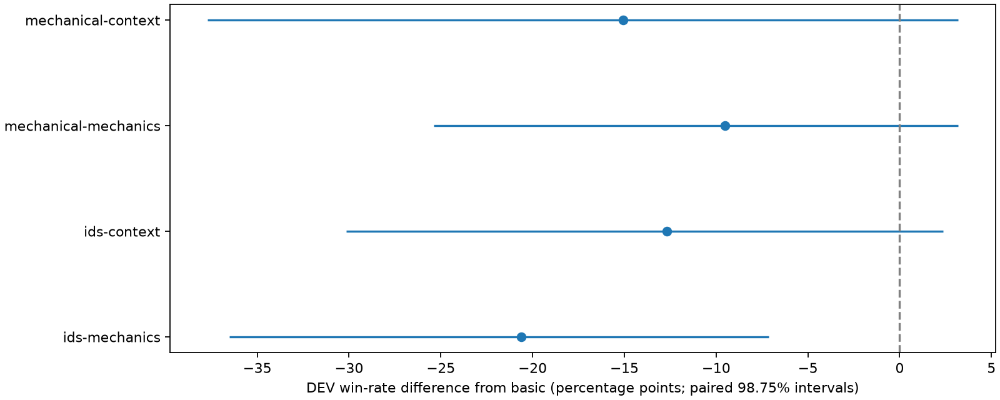
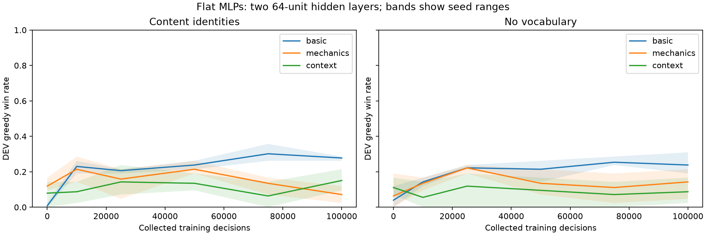

# Vantom flat MLPs at equal hidden width — 2026-10-13

The user requested a direct basic-versus-rich flat MLP comparison before any
hyperparameter tuning. The previous parameter-matched experiment narrowed rich
flat models to 8–9 hidden units. This follow-up holds both hidden layers at 64
units while allowing richer inputs more parameters.

**Complete: all 18 learners trained 100,000 decisions each.** Richer inputs did
not improve the mean 100k DEV result in either identity setting. Basic inputs
won every matched seed comparison. Only the detailed-mechanics versus basic
comparison with identities had a family-adjusted interval entirely below zero;
the other three adjusted intervals include zero. This supports keeping basic
tactical inputs as the flat MLP baseline under the current PPO/budget, rather than
concluding that the additional features have no potential value.

## Endpoint results

Greedy DEV uses the same 42 openings per seed. Sampled DEV uses two repetitions
of those openings (84 episodes per seed); repetitions are averaged within each
source fight for paired uncertainty. Seed columns are **11 / 29 / 47**, and all
numbers in those columns are percentages. TRAIN uses 101 openings per seed.

| Identities | Inputs | DEV greedy mean | DEV greedy seeds | DEV sampled mean | DEV sampled seeds | TRAIN greedy mean |
| --- | --- | ---: | --- | ---: | --- | ---: |
| Learned | Basic | **27.8%** | 26.2 / 28.6 / 28.6 | **23.4%** | 25.0 / 21.4 / 23.8 | 42.6% |
| Learned | Mechanics | 7.1% | 11.9 / 2.4 / 7.1 | 0.8% | 1.2 / 1.2 / 0.0 | 18.2% |
| Learned | Context | 15.1% | 21.4 / 9.5 / 14.3 | 0.4% | 1.2 / 0.0 / 0.0 | 19.5% |
| None | Basic | **23.8%** | 21.4 / 19.0 / 31.0 | **19.4%** | 21.4 / 15.5 / 21.4 | 30.4% |
| None | Mechanics | 14.3% | 16.7 / 4.8 / 21.4 | 2.8% | 7.1 / 0.0 / 1.2 | 19.5% |
| None | Context | 8.7% | 16.7 / 7.1 / 2.4 | 0.4% | 1.2 / 0.0 / 0.0 | 9.9% |

The four predeclared greedy comparisons are **richer minus basic**, in percentage
points. Intervals resample learner seeds and source fights together, preserving
pairs, with 10,000 bootstrap draws. The 98.75% intervals apply the planned
Bonferroni adjustment across four comparisons; this remains exploratory DEV
evidence after earlier TEST exposure.

| Identities | Comparison | Difference | Paired 95% interval | Adjusted 98.75% interval |
| --- | --- | ---: | --- | --- |
| Learned | Mechanics − basic | **−20.6 pp** | [−33.3, −9.5] | **[−36.5, −7.1]** |
| Learned | Context − basic | −12.7 pp | [−26.2, −0.8] | [−30.2, +2.4] |
| None | Mechanics − basic | −9.5 pp | [−21.4, 0.0] | [−25.4, +3.2] |
| None | Context − basic | −15.1 pp | [−31.7, 0.0] | [−37.7, +3.2] |

The curves help qualify the endpoint. Detailed mechanics with identities averaged
21.4% at 50k and 7.1% at 100k; basic with identities increased from 23.8% to 27.8%.
Thus extra training did not consistently improve the richer model. All richer
configurations also had lower TRAIN greedy means than their basic counterparts,
so the result is not explained by a larger TRAIN/DEV gap alone. Sampled wins were
0.4–2.8% for rich configurations versus 19.4–23.4% for basic. The last logged
updates generally retained more action entropy in rich models; several context
learners had nearly zero KL. These are signs of weak learning under this recipe,
not a diagnosis of which optimizer or representation change would fix it.

Basic with identities improved by 27.0 percentage points from initialization;
basic without vocabulary improved by 19.8 points. Identity usefulness is not
established by the four richness comparisons. The best mean here, 27.8%, also
does not improve on the earlier narrower basic model's 35.7% DEV result; that
cross-study observation is descriptive, not a separately registered width test.

The shaded bands show seed ranges, not confidence intervals.

## Cost and evidence limits

Mean training time per 100k learner excludes evaluation. Inference time is the
recorded DEV policy time per decision under the shared collector allocation,
not an isolated hardware microbenchmark.

| Identities | Inputs | Training minutes | PPO update seconds | Inference ms/decision |
| --- | --- | ---: | ---: | ---: |
| Learned | Basic | 9.17 | 82.1 | 5.70 |
| Learned | Mechanics | 14.66 | 348.0 | 8.50 |
| Learned | Context | 15.13 | 371.0 | 8.92 |
| None | Basic | 8.98 | 71.3 | 5.76 |
| None | Mechanics | 13.59 | 287.2 | 8.31 |
| None | Context | 14.14 | 312.9 | 9.04 |

Rich models took about 1.5–1.7 times the training time and 1.4–1.6 times the
recorded inference time of their basic counterparts. Parent RSS is a cumulative
process peak and excludes collector processes, so it cannot give a clean
per-configuration memory comparison.

The explicit missing-enemy-history rate was zero in endpoint DEV play. Other
history fields remain incomplete: turn-play counters were unknown on 11.5–13.0%
of context decisions and status-draw counts on 83.9–90.1%. Many channels were
constant in this Vantom corpus, and optional numeric operands are not applicable
to every entity. The saved per-channel coverage audits must qualify any claim
about a particular feature's usefulness.

Recommendation: keep the basic tactical flat MLP as the baseline for subsequent
shared-PPO tuning. Equal width removes the earlier 8–9-unit bottleneck explanation,
but larger input matrices also introduce many more parameters. This experiment
does not separate information value from optimization, representation or sample
efficiency, and does not establish that richer inputs cannot help with another
architecture or training budget. No default model was changed.
The subsequent [entity-encoder comparison](VANTOM_ENTITY_ENCODING_2026_10_14.md)
tests that architectural question; the [shared PPO calibration](VANTOM_SHARED_PPO_2026_10_15.md)
tests recipe transfer without selecting hyperparameters separately for each model.

## Frozen design

- Basic, detailed mechanics and mechanics plus context, each with learned
  identities and without vocabulary: six configurations.
- Seeds 11, 29, 47; fresh random initialization; 100,000 collected decisions per
  learner; no warm-up, demonstrations, transferred weights, search or previews.
- 18 learners and 1.8 million decisions. The earlier learners are not reused.
- Same PPO settings, rewards, sampling, RNG stream derivation, 16 collectors,
  four learner threads and bounded training chunks as the completed parent study.
- Greedy DEV at 0/10k/25k/50k/75k/100k; two sampled DEV repetitions and greedy
  TRAIN openings at 100k. No TEST access or reselection.
- Four predeclared richer-minus-basic endpoint comparisons within identity
  setting, using paired bootstrap over source fights and learner seeds. Report
  both exploratory 95% and family-adjusted 98.75% intervals.

| Inputs | With identities | Without vocabulary |
| --- | ---: | ---: |
| Basic tactical | 2,521,650 parameters | 2,453,634 parameters |
| Detailed mechanics | 14,602,290 parameters | 14,534,274 parameters |
| Mechanics plus context | 15,675,570 parameters | 15,607,554 parameters |

The [configuration](../../configs/training/vantom_flat_width_study.json) and
[training guide](../AGENT_TRAINING.md#equal-width-flat-mlp-follow-up) own settings
and usage. The prior [96-learner study](VANTOM_FEATURE_STUDY_2026_10_12.md) remains
complete and unchanged. Width 64 was chosen before follow-up outcomes; it is a
common rounded width near the prior basic models' 51/52 units.

## Information and evidence boundaries

The original TEST reservation permanently closes the original study source.
The new development-only derivative preserves original cases, split ownership,
hashes and reservation bytes. It binds the completed parent manifest/source,
original delegation chain and terminal TEST reservation; it explicitly records
prior TEST exposure. Only original TRAIN/validation rows enter the new native
snapshot and public-prefix verifier. TEST cases are absent from its case table,
and TEST restoration/reservation is rejected. No source lock is removed or repinned.

Training keeps 101 TRAIN fights/668 starts and evaluation keeps 42 DEV openings.
The semantic projection, TRAIN-fitted vocabulary, capacities and mechanics
catalog come from the parent experiment. Native TRAIN/DEV prefixes and public
history are reverified under current source. No model/encoder/PPO behavior is
changed for the comparison; the training/evaluation machinery is reused.

This tests the richer representation with larger input matrices at fixed hidden
width. It does not isolate information value from every effect of increased
parameter count. Results are exploratory after earlier TEST exposure; three
seeds, one boss dataset and incomplete mechanics/history remain limitations.

## Execution and validation

The independent semantic review accepted implementation build
`c03edca7182b52df45c887bcbd81bef2f5df66a10b6c6823cc3b1871e8650296`
at 2026-10-12 22:50:22 UTC. The review found and resolved two provenance issues:
cached restoration now binds the parent's verified source and reservation mirror,
and source loading detects dependency changes during hash validation. The final
review took 226 seconds; an earlier design review interval took 211 seconds,
including waiting. No TEST gameplay was accessed by the reviewer.

The eight follow-up boundary tests and affected feature protocol/search source
tests passed (38 tests, 41.64 seconds). The unchanged feature study checks had
already passed during implementation. Corpus, parallel evaluation and checkpoint
integration checks also passed (62 tests, 151.84 seconds). Compilation and
`git diff --check` passed. Overall implementation time was not instrumented and
is not estimated.

The public output is
`/Users/rowdeygoos/code/github/RowdeyGoos/StS_agent/runs/vantom-flat-width-20261013`.
Current-source verification of all 935 TRAIN/DEV starts and their public prefixes
passed in 723.98 seconds, ending at 2026-10-12 23:02:51 UTC. The derivative retains
101 TRAIN fights/668 starts and 42 DEV fights/267 starts. Its freshly reconstructed
public-history supplement has exactly the same hash as the parent supplement.
The new source identity is
`sts_verified_development_feature_source_v1:6c9c083bd6330eae773c762ad4a921185cbc866be97477c72dd93c29ff3d24eb`.

All six disposable 128-decision smoke learners passed (768 decisions separate
from the formal budget) in 85.83 seconds, ending at 2026-10-12 23:04:16 UTC.
The preflight records actual phase start/end times and exit status in
`preflight.json`, with separate logs.

The full sequential experiment ran from **2026-10-12 23:04:46 UTC** to
**2026-10-13 03:15:10 UTC** (October 13, 01:04:46–05:15:10 Europe/Amsterdam), exiting
successfully after **15,024.63 seconds / 4h 10m 25s**. The frozen manifest SHA-256 is
`531a128031a4e2dbb375dd82abe483ec45cb9fb735aa194aca7e47a2e309940c`.
`execution.json` records process identity, start/end time and exit status;
`progress.json` records the latest evaluation milestone. The launcher retains
failures without automatic retries and prevented idle sleep only while running.
All **1,800,000 decisions were collected and trained**, with zero skipped decisions,
zero skipped updates and zero failed training episodes. Training accounted for
13,622.55 seconds (3h 47m 3s); evaluation for 1,166.61 seconds (19m 27s). The
remaining wall time includes initialization, orchestration and reporting. There
were 9,461 rewarded training episodes. All 7,866 evaluation episodes terminated,
with no evaluation failures or cutoffs.

Here, trained decisions count decisions in updated rollouts; unique gradient
coverage was not measured by this historical run. The
[later calibration](VANTOM_SHARED_PPO_2026_10_15.md#learning-dynamics-and-optimizer-exposure)
records optimizer coverage separately.

The final read-only artifact audit passed in 10.17 seconds at
2026-10-13 03:49:42 UTC. It checked all 18 configurations/seeds, 216 bounded
training segments, zero-update initialization, continuation manifest equality,
final checkpoint hashes, all 144 evaluation bindings and case/mode/repeat sets,
all public trajectory files, recomputed endpoint metrics and paired intervals,
and unchanged parent reservation provenance. All 18 learner runs plus the
comparison run are FINISHED in MLflow; endpoint metrics and all four published
report/plot artifact hashes match the final files. Both plots were visually
inspected. No TEST gameplay was opened. Final audit details are saved as
`final-audit.json` beside the frozen manifest.
The completed comparison report SHA-256 is
`0c1a0858431362cecf2d6af3e2a745fa8b3927739d5a4384b9f1a999f4336066`.

The local [MLflow comparison](http://127.0.0.1:5052/#/experiments/1/runs) contains
all results. The output's `report/README.md`, `report/comparisons.json`,
`report/learning-curves.png` and `report/richness-comparisons.png` are the detailed
report and figures. Checkpoints, public trajectories and private resume artifacts
remain in the study output. The completion-check automation is paused after
completion reporting; it does not authorize extra training or TEST access.
