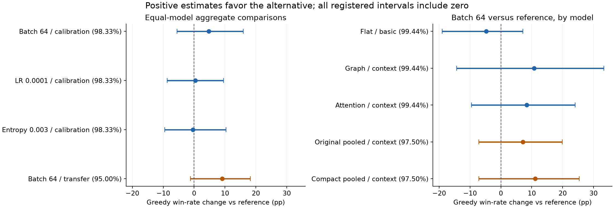
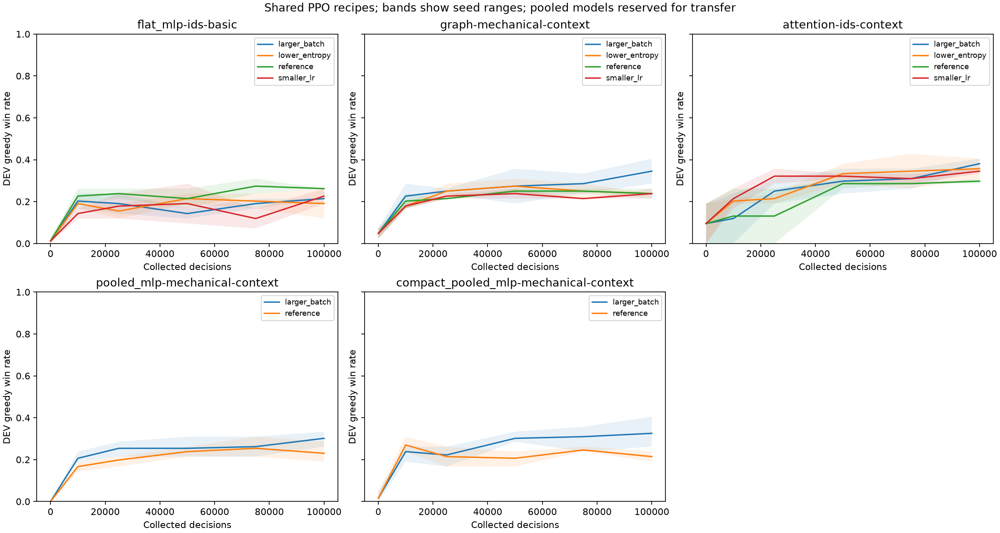
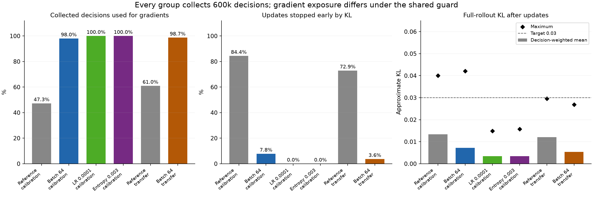

# Vantom shared PPO calibration — 2026-10-15

Status: **complete**. All 36 learners and evaluations finished at 2026-10-16
01:15:08 UTC with exactly 3.6M collected training decisions. The registered rule
retains the reference recipe; no default model or training setting changed.

The user authorized the previously proposed hyperparameter experiment to find
one reusable PPO recipe across models. This study screens four recipes on a fixed
three-model panel, then tests one frozen alternative against the reference on two
excluded pooled models with fresh seeds. It does not tune each model separately.
The source is the existing Vantom population: 101 TRAIN fights / 668 starts and
42 DEV openings. Prior TEST exposure makes all conclusions exploratory. No new
TEST gameplay, reservation or confirmation is authorized.

## Frozen design

Configuration: [vantom_shared_ppo_study.json](../../configs/training/vantom_shared_ppo_study.json).
Output: `runs/vantom-shared-ppo-20261015` in the primary repository.
All models use width 64 and fresh random initialization. Each learner collects
exactly 100,000 environment decisions, regardless of wins or skipped updates.

| Recipe | Learning rate | Minibatch | Entropy weight |
| --- | ---: | ---: | ---: |
| reference | 0.0003 | 16 | 0.01 |
| larger_batch | 0.0003 | 64 | 0.01 |
| smaller_lr | 0.0001 | 64 | 0.01 |
| lower_entropy | 0.0001 | 64 | 0.003 |

The adjacent recipes isolate a larger minibatch, then a lower learning rate,
then lower entropy. This is a small practical screen, not a factorial estimate
of all hyperparameter interactions.

| Stage | Models | Seeds | Learners / collected decisions |
| --- | --- | --- | ---: |
| Calibration | basic flat MLP with identities; context graph without vocabulary; context attention with identities | 11, 29 | 24 / 2,400,000 |
| Transfer | context original pooled MLP without vocabulary; context compact pooled MLP without vocabulary | 71, 101, 137 | 12 / 1,200,000 |

Transfer compares only the reference and one selected alternative. Its models
and seeds do not participate in selection. The full budget is **36 learners /
3,600,000 collected decisions**. Twenty disposable 128-decision TRAIN-only smoke
learners cover every possible model/recipe combination separately from this budget.

| Model | Connected trainable parameters at width 64 |
| --- | ---: |
| Basic flat MLP, identities | 2,521,650 |
| Context graph, no vocabulary | 152,322 |
| Context attention, identities | 204,722 |
| Context original pooled MLP, no vocabulary | 144,130 |
| Context compact pooled MLP, no vocabulary | 97,698 |

These are the same fixed models within each recipe comparison; this study does
not match parameter counts between architectures. Identity embeddings contribute
1,456 parameters in the two identity-enabled models.

## Update semantics and controls

Every recipe uses the new `minibatch_v1` KL guard, bound by
`sts_ppo_experiment_v3`. Approximate KL against the frozen collection policy is
checked before each additional optimizer step; exceeding 0.03 stops that update.
The full-rollout check after an epoch or partial epoch remains. A divergence
before the first step fails explicitly. The guard does not roll back a previous
step, and its noisy minibatch estimate is not a hard trust-region guarantee.

This follows the general per-minibatch stopping approach in
[Stable-Baselines3 PPO](https://stable-baselines3.readthedocs.io/en/master/_modules/stable_baselines3/ppo/ppo.html),
with an explicit threshold of 1× our target, rather than its 1.5× multiplier.
The reference here therefore differs from historical PPO by the guard. Comparing
these recipes cannot establish the guard's causal benefit over an earlier study.
Legacy v1/v2 experiment serialization, identity and epoch-only behavior remain
unchanged. Exact resume rejects changing the guard or recipe.

All other PPO controls remain fixed: rollout 4,096; two epochs; gamma 1.0;
GAE lambda 0.95; clip 0.2; value weight 0.5; gradient clipping 0.5; advantage
normalization; victory + 0.1 settled winning HP fraction; `commit_decisions_v1`;
512-decision / 120-second episode limits. Allocation is 16 collectors and four
learner threads. Learners run sequentially in deterministic shuffled seed blocks.
Initialization, environment, action and minibatch RNG streams remain separate.
Paired streams do not imply identical trajectories after policies diverge.

The existing bounded chunks end at 10k, 20k, 25k, 35k, 45k, 50k, 60k, 70k,
75k, 85k, 95k and 100k, retaining optimizer/RNG state. Greedy DEV evaluation
occurs at 0, 10k, 25k, 50k, 75k and 100k. At 100k, add two paired sampled
DEV repetitions and greedy evaluation on all 101 TRAIN openings.

The zero-signal guard stays enabled. `trained_decisions` retains its historical
meaning: decisions in a rollout with an optimizer update. New fields separately
record unique decisions actually used by the optimizer, visits including repeated
epochs, and decisions not visited because of KL stopping. Zero-signal skips are
reported separately; missing historical optimizer measurements stay unavailable.

## Selection and recommendation

The primary endpoint is 100k greedy DEV wins, averaged equally across the three
fixed models and two seeds. An alternative is eligible only if no model's mean
falls by more than five percentage points against the reference. Rank alternatives
by eligibility, mean wins, worst model change, fewer severe KL updates, lower
mean within-model seed variation, sampled wins, then recipe ID. A severe update
has full post-update approximate KL above 0.06.

Freeze calibration checkpoint hashes, statistics, selected alternative and the
12-learner transfer schedule before any transfer training. If every alternative
is ineligible, still test the strongest alternative under this same ranking; it
cannot become the recommended preset. Interrupted publication reuses the frozen
calibration snapshot, without reselection.

Recommend the alternative only if all of these hold:

- Every calibration model passes the −5 percentage point floor.
- The calibration aggregate paired interval excludes zero in its favor after
  adjusting for three alternative-versus-reference comparisons.
- The aggregate fresh-seed transfer 95% paired interval excludes zero in its favor.
- Neither transfer model declines by more than five percentage points.
- Its severe-KL update rate on transfer is no more than five percentage points
  above the reference rate.

Otherwise retain the reference recipe. The result is an **opt-in research preset**;
no default model or production configuration changes automatically. The cross-model
transfer approach is informed by
[Cross-Environment Hyperparameter Tuning for Reinforcement Learning](https://rlj.cs.umass.edu/2024/papers/Paper330.html),
adapted here to architectures within one combat dataset; it does not establish
cross-environment robustness.

Paired bootstrap intervals resample source fights and learner seeds. Fixed models
are averaged within each seed/fight and are not resampled as random independent
tasks. The calibration aggregate family has three comparisons; per-model screening
has nine. Transfer per-model intervals adjust for two comparisons; its aggregate
is one preselected comparison. Sampled repeats are averaged within fights. Two
screening seeds and three transfer seeds leave coarse uncertainty estimates.

Report per-model and per-seed greedy/sampled endpoints, initial improvements,
TRAIN/DEV gaps, learning curves, KL, clipping, entropy, critic error, reward onset,
zero-signal skips, optimizer coverage, throughput, inference cost and timings.
Retain feature/history coverage limitations. Stability helps break close screening
ties; smooth curves alone are not evidence of a better policy.

## Validation and execution evidence

The implementation reuses the study source verifier, public history, native
collectors, checkpoint/resume, evaluation recorder, MLflow and plotting components.
It creates a verified current-source TRAIN/DEV derivative with the original source
ownership chain; it does not repin historical corpus evidence or unlock TEST.

Focused checks cover legacy configuration identity, changed-recipe rejection,
pre-step KL stopping, full-rollout diagnostics, optimizer coverage, zero-signal
skips, exact serial/parallel checkpoint continuation, model and recipe bindings,
evaluation seed/checkpoint/mode/limit/fight bindings, paired aggregation, exclusion
of transfer outcomes, and interruption-safe selection. The binding validator also
accepted the 12 real chunks and eight evaluations of the completed October 14
compact/context seed-11 learner without replaying gameplay.

Independent semantic review completed at **2026-10-15 19:01:26 UTC**, taking
**10m49s** including correction checks. It found no remaining semantic blocker.
Its independent checks included 12 tests, ten evaluation-binding rejection probes
and restored-weight payload checks, with no training or TEST gameplay. The final
affected integration suite passed **251 tests in 125.64s**; compilation of `game`
and `tests`, and the whitespace diff check passed. Source-bound records are
`semantic-review.json` and `integration-validation.json` in the output directory.

Reviewed Python build identity:
`3639c46e7d011e0200c38ea969db80736a68f307887b6a67fd002f2cc9e1a74d`.
Rules remain
`a7aff887d75dc4de4e2691bb261c72886bdb863f47239dc7b025e71d008ee5cb`.

The one-shot gated pipeline launched at **2026-10-15 19:05:27 UTC**. It waited for
the already-running source verification, ran all 20 disposable smokes, checked
identical initial weight hashes within each model across recipes, and launched the
36-learner study after success. No automatic retry occurred.
`pipeline.json`, the phase execution records and `preflight.json` record actual
phase times. Native verification completed all **935 TRAIN/DEV starts** in
**631.93s (10m32s)**. All **20 smokes / 2,560 disposable decisions** completed in
**219.09s (3m39s)**, with identical initial weight hashes across recipes for each
model. Main training began at **2026-10-15 19:16:33 UTC**, recorded in
`execution.json`. The manifest SHA-256 is
`8bf000823b791f2cdeb9d61dc301e9e5e2b75b703376bdb3a3b97066fab7e520`.
The 19:36 UTC health check verified source/manifest bindings, TRAIN/DEV-only source
ownership, smoke budget and the completed learner's 100k budget and checkpoint hash.

The [local MLflow comparison](http://127.0.0.1:5054/#/experiments/1) passed its
health and experiment-store checks. All completed learners and comparison artifacts
are published. The `finish-vantom-shared-ppo-calibration` monitor checked every
30 minutes and is paused after completion.
Implementation elapsed time was not separately instrumented; no estimate is asserted.

## Results

All **36 learners, 3,600,000 collected decisions and 15,732 evaluation episodes** completed.
The registered recommendation is **retain the reference recipe**: learning rate 0.0003,
minibatch 16 and entropy weight 0.01, with the common `minibatch_v1` guard used in this study.
The `report/shared-preset.json` artifact binds that opt-in recipe and the recommendation
checks to this manifest. No production/default model or training setting changed.

Batch 64 was the strongest alternative. It increased mean greedy wins from **26.6% to
31.3%** in calibration and **22.2% to 31.3%** on the two pooled transfer models. Its
calibration gain was **+4.8 pp, adjusted interval [−5.6, +15.9]**; its transfer gain was
**+9.1 pp, 95% interval [−1.2, +18.3]**. Both adoption checks failed because their
intervals include zero. This does not establish equivalence or prove batch 64 is worse.
It is the most promising alternative in this screen, but there is insufficient evidence
to replace the reusable reference under the registered rule.

### Calibration endpoints

Entries show **mean (seed 11 / seed 29)**. Sampled rates average the two paired
repetitions on 42 DEV openings; each seed therefore has 84 sampled episodes.
TRAIN is greedy on 101 openings. Gaps are TRAIN minus DEV greedy in percentage points.

| Recipe | Model | DEV greedy | DEV sampled | TRAIN mean | Gap |
| --- | --- | ---: | ---: | ---: | ---: |
| Reference | Flat / basic | 26.2% (26.2 / 26.2) | 20.8% (22.6 / 19.0) | 36.6% | +10.4 |
| Reference | Graph / context | 23.8% (21.4 / 26.2) | 23.2% (25.0 / 21.4) | 43.6% | +19.8 |
| Reference | Attention / context | 29.8% (28.6 / 31.0) | 22.0% (23.8 / 20.2) | 41.1% | +11.3 |
| Batch 64 | Flat / basic | 21.4% (21.4 / 21.4) | 25.0% (22.6 / 27.4) | 41.1% | +19.7 |
| Batch 64 | Graph / context | 34.5% (40.5 / 28.6) | 31.0% (31.0 / 31.0) | 47.0% | +12.5 |
| Batch 64 | Attention / context | 38.1% (40.5 / 35.7) | 25.6% (23.8 / 27.4) | 44.6% | +6.5 |
| Lower LR | Flat / basic | 22.6% (26.2 / 19.0) | 19.6% (21.4 / 17.9) | 32.2% | +9.6 |
| Lower LR | Graph / context | 23.8% (26.2 / 21.4) | 17.9% (14.3 / 21.4) | 41.1% | +17.3 |
| Lower LR | Attention / context | 34.5% (35.7 / 33.3) | 25.6% (27.4 / 23.8) | 45.0% | +10.5 |
| Lower entropy | Flat / basic | 19.0% (26.2 / 11.9) | 22.0% (25.0 / 19.0) | 33.2% | +14.1 |
| Lower entropy | Graph / context | 23.8% (23.8 / 23.8) | 25.0% (26.2 / 23.8) | 42.6% | +18.8 |
| Lower entropy | Attention / context | 35.7% (40.5 / 31.0) | 28.0% (31.0 / 25.0) | 43.6% | +7.9 |

| Recipe | Equal-model greedy | Equal-model sampled | Mean within-model seed SD | Eligible |
| --- | ---: | ---: | ---: | --- |
| Reference | 26.6% | 22.0% | 1.19 pp | yes |
| Batch 64 | 31.3% | 27.2% | 2.78 pp | yes |
| Lower LR | 27.0% | 21.0% | 2.38 pp | yes |
| Lower entropy | 26.2% | 25.0% | 3.97 pp | no |

Lower entropy failed the five-point model floor because flat greedy wins fell by
7.1 pp. Lower LR passed that floor but had only a +0.4 pp aggregate greedy estimate.
Batch 64 passed the floor narrowly: flat declined by 4.8 pp, while graph and attention
improved by 10.7 and 8.3 pp. These results show model interactions; no recipe dominated
all three calibration models.

### Fresh-seed transfer

Selection was frozen before transfer initialization. Entries show **mean (seed 71 /
101 / 137)**. Only the reference and the preselected batch-64 recipe were run.

| Recipe | Model | DEV greedy | DEV sampled | TRAIN mean | Gap |
| --- | --- | ---: | ---: | ---: | ---: |
| Reference | Original pooled / context | 23.0% (28.6 / 19.0 / 21.4) | 21.8% (23.8 / 22.6 / 19.0) | 40.3% | +17.2 |
| Reference | Compact pooled / context | 21.4% (23.8 / 21.4 / 19.0) | 20.6% (21.4 / 21.4 / 19.0) | 38.9% | +17.5 |
| Batch 64 | Original pooled / context | 30.2% (33.3 / 26.2 / 31.0) | 26.6% (28.6 / 20.2 / 31.0) | 42.9% | +12.7 |
| Batch 64 | Compact pooled / context | 32.5% (26.2 / 40.5 / 31.0) | 24.2% (17.9 / 29.8 / 25.0) | 41.9% | +9.4 |

Batch 64 improved greedy wins in all six paired transfer learners. Original pooling
gained 7.1 pp (adjusted 97.5% interval [−7.1, +19.8]); compact pooling gained
11.1 pp ([−7.1, +25.4]). Its aggregate sampled gain was +4.2 pp (95% interval
[−1.6, +10.9]). Transfer uses the same 42 DEV source fights with fresh learner seeds;
it is a test of transfer to excluded models, not a newly held-out dataset.

### Paired uncertainty and decision

| Stage / alternative | Greedy change | Registered greedy interval | Sampled change | Sampled 95% interval |
| --- | ---: | --- | ---: | --- |
| calibration / Batch 64 | +4.8 pp | [-5.6, +15.9], 98.33% | +5.2 pp | [-1.6, +12.1] |
| calibration / Lower entropy | -0.4 pp | [-9.5, +10.3], 98.33% | +3.0 pp | [-1.2, +7.1] |
| calibration / Lower LR | +0.4 pp | [-8.7, +9.5], 98.33% | -1.0 pp | [-5.2, +4.0] |
| transfer / Batch 64 | +9.1 pp | [-1.2, +18.3], 95.00% | +4.2 pp | [-1.6, +10.9] |

All 15 registered greedy comparisons, including the per-model screening contrasts,
have intervals containing zero under their registered family adjustment (the
preselected transfer aggregate uses an ordinary 95% interval). The full values and paired seed
differences remain in `report/comparisons.json`. Both transfer models passed the
regression floor, and the severe-KL gate passed. The two aggregate uncertainty
checks prevented adoption.

### Learning dynamics and optimizer exposure

The reference calibration mean moved from 5.2% at initialization to 25.0% at 50k and
26.6% at 100k. Batch 64 moved from the same 5.2% to 23.8% at 50k and 31.3% at 100k.
On pooled transfer, reference/batch-64 means were 22.2%/27.8% at 50k and
22.2%/31.3% at 100k. Conclusions depend on the fixed endpoint; the reference and
batch-64 ranking reversed between 50k and 100k during calibration.

Curves still swing. For example, reference attention seed 29 started at 8/42 DEV
wins, fell to zero at both 10k and 25k, and reached 13/42 at 100k. Batch 64 had
higher calibration within-model seed variation than the reference (2.78 versus
1.19 pp mean population SD across the two seeds). Lower observed KL did not make
win rates monotonic or establish lower outcome variance.

All 1,152 rollout updates had learning signal. There were **zero skipped updates, zero
zero-signal skipped decisions and zero failed training episodes**. All 3.6M decisions
belonged to updated rollouts, but only **3,029,392 unique collected decisions** reached
an optimizer step, with **5,631,168 visits** including repeated epochs. KL stopping
left **570,608 decisions (15.85%)** unvisited. This is distinct from zero-signal skipping.

| Stage / recipe | Unique decisions used | Optimizer visits | KL-stopped updates | Full KL mean / max | Entropy | Clip fraction | Critic MSE |
| --- | ---: | ---: | ---: | ---: | ---: | ---: | ---: |
| calibration / Reference | 283,520 / 600k (47.3%) | 375,208 | 162/192 | 0.0133 / 0.0400 | 0.825 | 14.0% | 0.0453 |
| calibration / Batch 64 | 588,160 / 600k (98.0%) | 1,146,344 | 15/192 | 0.0072 / 0.0420 | 0.853 | 8.6% | 0.0380 |
| calibration / Lower LR | 600,000 / 600k (100.0%) | 1,200,000 | 0/192 | 0.0034 / 0.0149 | 0.866 | 3.9% | 0.0389 |
| calibration / Lower entropy | 600,000 / 600k (100.0%) | 1,200,000 | 0/192 | 0.0035 / 0.0158 | 0.848 | 4.3% | 0.0388 |
| transfer / Reference | 365,728 / 600k (61.0%) | 540,832 | 140/192 | 0.0121 / 0.0295 | 0.786 | 12.5% | 0.0513 |
| transfer / Batch 64 | 591,984 / 600k (98.7%) | 1,168,784 | 7/192 | 0.0054 / 0.0269 | 0.843 | 6.4% | 0.0439 |

KL, entropy, clipping and MSE means above weight full post-update rollout measurements
by collected decisions. No full-rollout KL exceeded the registered severe threshold
0.06; the maximum was 0.0420. A minibatch estimate reached 0.2798 and stopped further
steps, illustrating its variability. Batch 16 triggered much more early stopping than
batch 64 and used less than half of calibration decisions for gradients. The comparisons
therefore include changes in optimizer exposure under the common guard. They do not
isolate minibatch variance at equal optimizer visits, nor establish the guard itself
as better than historical epoch-only stopping.

Training recorded 37,661 rewarded episodes in 183,156 attempts. First rewards occurred
within 68–755 collected decisions on calibration and 117–628 on transfer. The 17,547
training truncations were recorded as `decision_budget` cutoffs from bounded collection.
All 15,732 evaluation episodes terminated normally; none hit a cutoff.

### Cost and coverage

The main run finished at **2026-10-16 01:15:08 UTC** in **21,515.16s (5h58m35s)**.
Summed bounded training calls took 18,774.66s (5h12m55s); within them, collection took
16,358.76s (4h32m39s) and updates 2,083.05s (34m43s). Evaluation took 2,090.64s
(34m51s). Remaining time includes initialization, checkpoint I/O and repeated reports.
These components are nested and must not all be added as independent durations.

| Model | Throughput reference / batch 64 (decisions/s) | DEV inference reference / batch 64 (ms) | Peak packed rollout (MiB) | Peak input minibatch reference / batch 64 (MiB) |
| --- | ---: | ---: | ---: | ---: |
| Flat / basic | 209.5 / 207.2 | 5.59 / 5.51 | 44.1 | 3.32 / 13.26 |
| Graph / context | 202.8 / 192.7 | 6.63 / 6.84 | 823.6 | 15.67 / 62.67 |
| Attention / context | 189.6 / 167.5 | 7.22 / 7.44 | 823.3 | 15.67 / 62.67 |
| Original pooled / context | 199.5 / 195.3 | 6.77 / 6.75 | 821.4 | 15.67 / 62.68 |
| Compact pooled / context | 195.9 / 191.9 | 11.53 / 11.80 | 124.9 | 0.55 / 2.08 |

Throughput uses collected decisions divided by bounded training wall time; inference
includes public encoding and model inference in recorded DEV play. Input tensors and
packed rollouts exclude model/optimizer storage and other process memory. The sequential
parent process reached a 3.39 GiB RSS high-water mark, excluding collector processes;
this is not an isolated per-model memory comparison. Parameters are listed above.

In endpoint DEV audits, **123/293 basic channels** and **1,337–1,355/1,874 context
channels** were constant within a learner. Rich enemy-history missing rates were zero
on these opening evaluations, but that does not establish completeness for every
possible continuation. Public play/attack/skill/energy/zero-cost-attack counters were
unknown on 12.2–15.8% of decisions; status-draw counts were unknown on 82.2–86.9%.
Twenty-two numeric channels were always unknown in every rich endpoint audit, including
item counters and several uncommon effect operands. Absent effects and irrelevant
content also produce constant channels. These facts limit feature-importance and
broader-game claims; this experiment calibrates PPO on the represented Vantom tasks.

### Completion audit and artifacts

The read-only completion audit took **46.71s** with the original deterministic runtime.
It verified all 432 bounded training chunks and their checkpoint bindings, all 288 evaluation bindings and episode
sets, all 72 initial/final private optimizer/RNG restores, paired initial weight hashes,
the frozen selection before transfer, all 15 recomputed bootstrap comparisons, the
recommendation and the preset binding. It executed no gameplay. All original TEST
reservations remain unchanged, and the derivative still rejects TEST access.

- Canonical report SHA-256: `f392208d989b80f12338ba7857b85bef458c6fc825b7280770e1cb59dfbdae96`.
- Selection SHA-256: `9baa5b1f7362d65c78717988b77d86e02bef988815d83a8eafac87ceb1f048b8`.
- Calibration snapshot SHA-256: `b50f0447fe8a1ff4b352e16219238f86b3fe76bf9b63fbecacdddcb642de17f7`.
- Opt-in preset SHA-256: `80d68f5ded645d25b2a107612e999510437a489e130907ed121363027d848118`.
- Derived audit and diagnostics: `report/completion-analysis.json`.
- Canonical learner reports, trajectories, checkpoint chains and private resume files
  remain in their original output directories.

The existing learning-curve plot and the new contrast/diagnostic plots were visually
checked. MLflow contains **36 finished learner runs and one finished comparison run**;
endpoint values, configuration parameters and all six learning-curve milestones were
checked against the saved report. The derived diagnostics and figures are attached to
the comparison run. The completion monitor is paused after this report.

Use one common reference preset for subsequent model comparisons if a recipe must be
frozen now. Treat batch 64 as the leading alternative for a later, separately authorized
replication rather than choosing per-model settings from this small screen. These data
do not show that the reference is optimal: only two calibration seeds, three transfer
seeds, one dataset and a 100k budget were tested.

The [current findings](../AGENT_TRAINING.md#current-vantom-findings) connect this
result with the feature screen, equal-width flat comparison and typed-encoder
study. Keep each study's source identities and uncertainty intact when comparing
them; changes in guard semantics, architecture or width prevent causal conclusions
from cross-study score differences.
